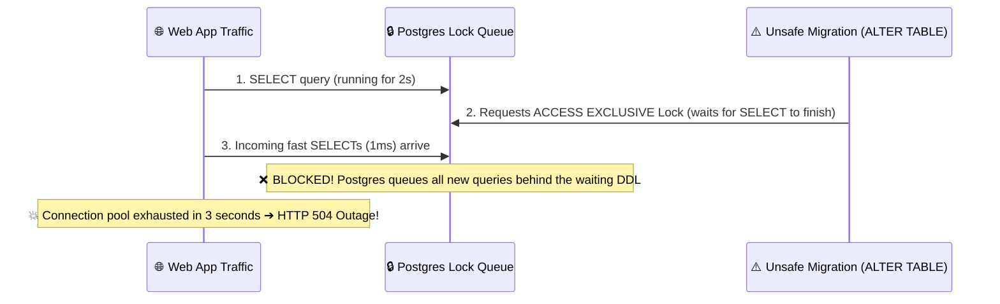

# 🛡️ Migration Guardian (`mgcheck`)

> **Catch unsafe database migrations before they lock production.**  
> A zero-downtime safety gate, AST rule engine, and disposable shadow PostgreSQL runner for humans and AI coding agents.

[](https://www.npmjs.com/package/mgcheck)
[](./LICENSE)
[](https://github.com/Aditya31032006/agent-safe-migrate/actions)
[](CONTRIBUTING.md)

---

## 🚨 The Hidden Crisis: The Reality of Migration Outages

Database schema migrations are the **single most dangerous operation in modern software deployments**. While application code can be rolled back in seconds, a flawed database migration can corrupt schema state, lock out customers, and cause catastrophic downtime.

```
┌──────────────────────────────────────────────────────────────────────────────────┐
│  💸 The Cost of Database Downtime                                               │
│                                                                                  │
│  • $5,600 / minute — Average cost of enterprise IT downtime (Gartner)           │
│  • 70%+ of outages — Triggered by schema changes & human/AI deployment errors    │
│  • 82% of developers — Have experienced database locks caused by naive DDL      │
└──────────────────────────────────────────────────────────────────────────────────┘
```

### 1. The "Lock Queue Death Spiral" (The #1 Production Killer)
Most developers know that `ALTER TABLE` requests an `ACCESS EXCLUSIVE` lock in PostgreSQL. What catches teams by surprise is the **Lock Queue**:



1. An unsafe migration attempts to add a column or modify a table.
2. It waits for an active transaction to complete.
3. **PostgreSQL queues every single incoming `SELECT`, `INSERT`, `UPDATE` behind the migration.**
4. Within 3 seconds, all database connections are exhausted $\rightarrow$ **The entire application goes down.**

### 2. The AI Agent Problem
AI coding agents (**Cursor, Claude Code, GitHub Copilot, Windsurf, Antigravity**) now generate database migrations daily. 

AI agents understand **schema intent** (e.g., *"add an email index"* or *"change status to string"*), but they have **zero context on production table size or lock mechanics**:
* They write `CREATE INDEX` instead of `CREATE INDEX CONCURRENTLY` (locks all writes).
* They write `ALTER COLUMN TYPE` instead of an expand/contract backfill (locks the entire table for a full rewrite).
* They forget `SET lock_timeout = '5s';`, triggering cascading lock queue death spirals.
* They drop columns and tables without human confirmation.

---

## 💡 How Migration Guardian (`mgcheck`) Solves This

Migration Guardian sits directly between your migration files and your database, acting as a **Zero-Trust Verification Gate**:

```mermaid
flowchart TD
    Agent["🤖 AI Agent / Developer"] --> Mgcheck["🛡️ npx mgcheck"]
    
    subgraph Analysis["Layer 1: Real AST Parser"]
        Mgcheck --> Parser["PostgreSQL AST Parser (WASM)"]
        Parser --> Rules["10 Production Safety Rules"]
    end

    subgraph Shadow["Layer 2: Disposable Shadow Database"]
        Rules --> Provider{"Shadow Provider"}
        Provider -->|Fast / In-Memory| PGlite["PGlite (WASM Postgres in Node.js)"]
        Provider -->|Full Fidelity| Docker["Docker (postgres:16-alpine)"]
        PGlite --> Execute["Seed Base Schema ➔ Execute Migration"]
        Docker --> Execute
    end

    subgraph Applier["Layer 3: Interactive Confirmation"]
        Execute --> Verified["✅ Verified Safe SQL Query Display"]
        Verified --> Confirm{"Apply to Real DB?"}
        Confirm -->|User Confirms [Y]| RealDB["🚀 Applied Safely to Target DB"]
        Confirm -->|User Declines [N]| Skip["ℹ️ Real DB Untouched"]
    end
```

1. **AST Structural Safety Analysis**: Uses official PostgreSQL C parser compiled to WebAssembly (`pgsql-parser`) to inspect the abstract syntax tree for lock hazards, table rewrites, and destructive drops.
2. **Ephemeral Shadow DB Execution**: Spins up an isolated, in-process PostgreSQL database (`PGlite`) or disposable Docker container, seeds your existing schema, and tests the migration in milliseconds.
3. **AI Agent Protection & Rule Injection**: Injects strict safety rules into `.cursorrules`, `CLAUDE.md`, `AGENTS.md`, and `.github/copilot-instructions.md` so AI models use MCP safety tools automatically.
4. **Verified SQL Real-Database Applier**: Once verified, prints the safe query in your terminal and interactively asks if you'd like to apply it to your live database.

---

## ⚡ Quickstart (Zero Configuration)

### 1. Interactive 1-Click Setup & Watch Mode

Run this in any project directory:

```bash
npx mgcheck
```

**What it does automatically:**
* 🔍 Detects your AI editors (**Cursor, Claude, Antigravity, Windsurf, Copilot**).
* ⚙️ Configures the MCP server so AI agents can call `check_migration` natively.
* 📝 Injects database safety rules into `.cursor/rules/`, `CLAUDE.md`, and `AGENTS.md`.
* 👁️ Starts **Live Watch Mode** to monitor and stream AI migration checks in real-time!

---

### 2. Run from the CLI

```bash
# Check and run against in-process shadow PostgreSQL
npx mgcheck run ./migrations/0001_add_users.sql --provider pglite

# Static rule analysis only (zero DB required)
npx mgcheck analyze ./migrations/0001_add_users.sql

# Test against seed schema
npx mgcheck run ./migrations/0002_add_index.sql --seed ./schema.sql

# Automated CI Gate (outputs JSON + non-zero exit code on failure)
npx mgcheck run ./migrations --ci
```

---

## 🛡️ 10 Production Safety Rules

| Rule ID | Severity | Name | Production Danger & Fix |
| :--- | :---: | :--- | :--- |
| **`MG001`** | `error` | `create-index-not-concurrent` | **Locks all table writes** during index builds. <br/>💡 *Use `CREATE INDEX CONCURRENTLY`.* |
| **`MG002`** | `error` | `alter-column-type` | **Triggers full table rewrite** under `ACCESS EXCLUSIVE` lock. <br/>💡 *Use the 4-step Expand/Contract pattern.* |
| **`MG003`** | `error` | `add-column-not-null-no-default` | Fails on existing rows / rewrites table. <br/>💡 *Provide a `DEFAULT` value.* |
| **`MG004`** | `warning` | `add-constraint-not-valid` | Scans all rows holding a heavy table lock. <br/>💡 *Add with `NOT VALID`, then run `VALIDATE CONSTRAINT`.* |
| **`MG005`** | `error` | `drop-column` | **Destructive & irreversible data loss**. <br/>💡 *Requires explicit `--confirm-destructive`.* |
| **`MG006`** | `error` | `drop-table` | **Destructive & irreversible data loss**. <br/>💡 *Requires explicit `--confirm-destructive`.* |
| **`MG007`** | `warning` | `rename-column` | Breaks running application code during rolling deployments. <br/>💡 *Use expand/contract view alias.* |
| **`MG008`** | `warning` | `rename-table` | Breaks running application code during rolling deployments. <br/>💡 *Use a database view alias.* |
| **`MG009`** | `warning` | `missing-lock-timeout` | Can cause **lock-queue death spiral outages**. <br/>💡 *Prepend `SET lock_timeout = '5s';`.* |
| **`MG010`** | `warning` | `missing-down-migration` | No rollback path if deployment fails. <br/>💡 *Create a corresponding `down.sql`.* |

---

## 📊 Comparison: Why Migration Guardian?

| Feature | Squawk | pgfence | Atlas | **Migration Guardian (`mgcheck`)** |
| :--- | :---: | :---: | :---: | :---: |
| **Open Source (MIT)** | ✅ | ✅ | ⚠️ (Pro paywall) | ✅ **100% Free & Open Source** |
| **True Postgres AST Parser** | ⚠️ Regex | ⚠️ Regex | ✅ | ✅ **Official `pgsql-parser` (WASM)** |
| **In-Process Shadow DB (No Docker needed)** | ❌ | ❌ | ❌ | ✅ **PGlite WASM Engine** |
| **Docker Shadow DB Provider** | ❌ | ❌ | ✅ | ✅ **Full Postgres Fidelity** |
| **MCP Server for AI Agents (Cursor/Claude)** | ❌ | ❌ | ❌ | ✅ **Native MCP Support** |
| **1-Click Agent Rule Injection** | ❌ | ❌ | ❌ | ✅ **`.cursorrules`, `CLAUDE.md`, `AGENTS.md`** |
| **Interactive Real DB Applier** | ❌ | ❌ | ❌ | ✅ **Prompt & Apply Verified SQL** |
| **Live Terminal Watch Mode** | ❌ | ❌ | ❌ | ✅ **Real-Time Stream** |

---

## 🤖 AI Coding Agent Integration (MCP)

Migration Guardian exposes an official **Model Context Protocol (MCP)** server:

* `check_migration`: Full shadow execution + 10 AST safety rules + suggested safe rewrites.
* `analyze_migration`: Ultra-fast static AST linting.

```json
{
  "mcpServers": {
    "migration-guardian": {
      "command": "npx",
      "args": ["mgcheck", "mcp"]
    }
  }
}
```

---

## 🔄 CI / CD Integration (GitHub Actions)

Add `mgcheck` to your GitHub Actions pipeline to block unsafe PRs automatically:

```yaml
name: Database Migration Safety Gate
on: [pull_request]

jobs:
  check-migrations:
    runs-on: ubuntu-latest
    steps:
      - uses: actions/checkout@v4
      - uses: actions/setup-node@v4
        with:
          node-version: 20
      - name: Verify Migrations with Migration Guardian
        run: npx mgcheck run ./prisma/migrations --ci --provider pglite
```

---

## 🗺️ Roadmap & Contributing

We welcome community contributions! Check out our [CONTRIBUTING.md](CONTRIBUTING.md) guide.

- [x] **v0 Core**: AST Parser, 10 Safety Rules, PGlite & Docker Shadow DB, CLI, MCP Server, Watch Mode, Real DB Applier.
- [ ] **v1 (Next Milestone)**: LLM Fix & Re-verify loop (`--llm-fix` with structured schema recovery).
- [ ] **v2**: Multi-database support (MySQL, SQLite, ClickHouse).

---

## 📄 License

MIT License © 2026 Aditya & The Migration Guardian Community.
