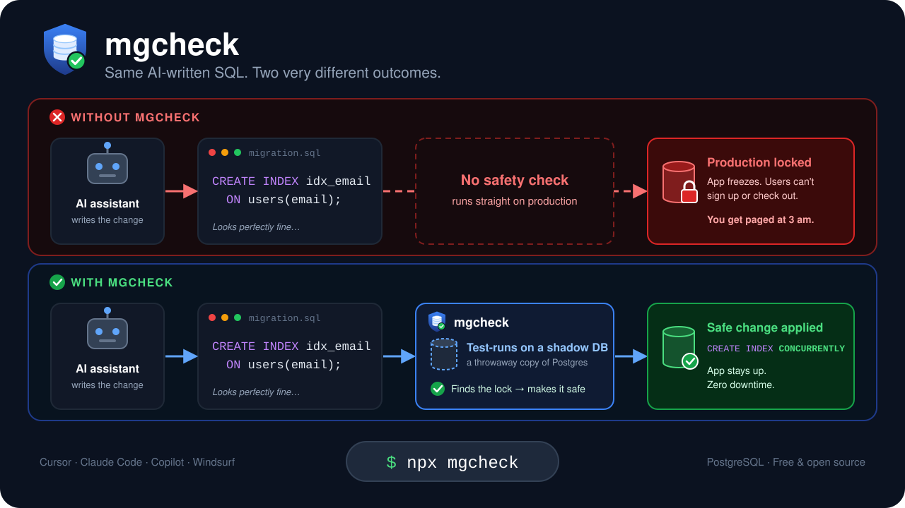

<div align="center">


# Migration Guardian

### `mgcheck` — catch unsafe database migrations before they lock production

**Compatible with PostgreSQL, Supabase, Neon, AWS RDS/Aurora, Cloud SQL, TimescaleDB & CockroachDB.**
**Whether the migration was written by you, a teammate, or an AI coding agent.**

[](https://www.npmjs.com/package/mgcheck)
[](https://www.npmjs.com/package/mgcheck)
[](https://github.com/Aditya31032006/agent-safe-migrate/actions/workflows/ci.yml)
[](./LICENSE)
[](https://nodejs.org/)
[](https://www.typescriptlang.org/)
[](https://modelcontextprotocol.io/)
[](#-contributing)
[](https://github.com/Aditya31032006/agent-safe-migrate/stargazers)

```bash
npx mgcheck
```

[Quickstart](#-quickstart) ·
[How it works](#-how-it-works) ·
[Safety rules](#%EF%B8%8F-the-14-safety-rules) ·
[Showcase](SHOWCASE.md) ·
[AI agents](#-ai-agent-integration-mcp) ·
[CI](#-ci--cd) ·
[Configuration](#%EF%B8%8F-configuration) ·
[API](#-programmatic-api) ·
[Security](SECURITY.md) ·
[Roadmap](#%EF%B8%8F-roadmap--help-wanted) ·
[Contributing](#-contributing)

<br>



</div>

> **Free and open source (MIT).** Migration Guardian is an early-stage, community-driven project. If you've ever been paged because a migration locked a table, you already have the domain knowledge to help — [new rules, framework detectors and fixes are very welcome](#-contributing).

---

## 🧭 Why Migration Guardian?

You can roll back application code in seconds. **A bad schema migration can take your database down in milliseconds** — and it usually looks completely harmless in review.

```sql
-- Looks fine. Passes local tests on 10 rows. Gets approved in review.
CREATE INDEX idx_users_email ON users(email);

-- In production:
--   • Takes a SHARE lock on "users" → every INSERT/UPDATE/DELETE blocks
--   • Requests queue behind the lock, the connection pool saturates
--   • Your API starts timing out while the index builds
```

This class of bug is getting **more common**, not less. AI coding agents (Claude Code, Cursor, Copilot, Windsurf, …) are great at writing the DDL that produces the schema you asked for, but they have no idea how big your tables are or how PostgreSQL locks behave under load.

**Migration Guardian sits between whoever writes the migration and the database that runs it.** It parses every statement with the real PostgreSQL grammar, flags dangerous lock and rewrite patterns, dry-runs the migration on a throwaway shadow database, and makes a human sign off on anything risky before it reaches a real database.

---

## ✨ Features

| | |
| :--- | :--- |
| 🔬 **Real PostgreSQL parser** | Uses [`pgsql-parser`](https://www.npmjs.com/package/pgsql-parser) — PostgreSQL's own grammar compiled to WebAssembly — so rules inspect real AST nodes rather than guessing from text. Statements the parser can't read are flagged (`MG014`) and checked by text matching. |
| 🧪 **Shadow database dry-run** | Executes the migration on an in-process [PGlite](https://pglite.dev/) instance (no Docker) or a disposable `postgres:16-alpine` container, then throws it away. |
| 🚦 **Risk-based approval gate** | Every migration is classified 🟢 LOW / 🟡 MEDIUM / 🔴 HIGH. HIGH risk is **never** auto-approved, under any configuration. |
| 🤖 **MCP server for AI agents** | One command wires `check_migration`, `analyze_migration` and `apply_migration` tools into 13 AI clients. |
| 👁️ **Live terminal watcher** | Approve, reject or override agent migrations in real time. Switch `auto` ⇄ `manual` mode with `Shift+Tab`. |
| 🔁 **Agent retry loop** | When a fixable violation is found, the agent gets the suggested safe SQL and is asked to rewrite and retry (up to 3 attempts). |
| 🛠️ **Auto-fix** | Rewrites common unsafe patterns into zero-downtime equivalents, shows a diff, and re-verifies the fix on a shadow DB. |
| 🪝 **Pre-commit hook & CI** | Block unsafe migrations at `git commit` and in pull requests (bundled GitHub Action included). |
| 📜 **Audit log** | Every intercepted migration, its risk level and the human decision are appended to `.mgcheck/audit.jsonl`. |
| 🧩 **Framework-aware** | Auto-detects Prisma, Drizzle, Supabase, Flyway, Goose, dbmate, golang-migrate and plain `.sql`. |

---

## ⚡ Quickstart

> **Requirements:** Node.js 18+. Docker is optional — use `--provider pglite` to run everything in-process.

### Choose your setup

| Method | Command | Usage |
| :--- | :--- | :--- |
| **No install (npx)** *(Recommended)* | *None needed* | `npx mgcheck <command>` |
| **Global install (npm)** | `npm install -g mgcheck` | `mgcheck <command>` |
| **Project devDependency** | `npm install -D mgcheck` | `npx mgcheck <command>` or npm script |

---

**1. Connect your AI agents and start the watcher**

```bash
npx mgcheck
```

The setup wizard detects installed AI clients, registers the MCP server, and opens the live approval watcher.

**2. Lint migrations statically (no database needed)**

```bash
npx mgcheck analyze ./migrations
```

**3. Lint + dry-run on a shadow database**

```bash
npx mgcheck run ./migrations --provider pglite --seed ./schema.sql
```

**4. Auto-fix an unsafe migration**

```bash
npx mgcheck fix ./migrations/20260101_add_email_index.sql
```

**5. Guard every commit**

```bash
npx mgcheck hook install
```

---

## 🔍 How it works

```
                 Developer  /  AI coding agent
                              │
                              ▼
 ┌──────────────────────────────────────────────────────────────┐
 │ ① Detect      Prisma · Drizzle · Supabase · Flyway · Goose · │
 │               dbmate · golang-migrate · raw .sql             │
 └──────────────────────────────┬───────────────────────────────┘
                                ▼
 ┌──────────────────────────────────────────────────────────────┐
 │ ② Analyze     PostgreSQL AST (WASM) checked against 14 rules │
 │               → locks, table rewrites, data loss, rollbacks  │
 └──────────────────────────────┬───────────────────────────────┘
                                ▼
 ┌──────────────────────────────────────────────────────────────┐
 │ ③ Shadow run  Execute on throwaway PGlite or Docker Postgres │
 │               (optionally seeded with your existing schema)  │
 └──────────────────────────────┬───────────────────────────────┘
                                ▼
 ┌──────────────────────────────────────────────────────────────┐
 │ ④ Gate        🟢 LOW     → approved                           │
 │               🟡 MEDIUM  → y/N prompt  (or agent retry, auto) │
 │               🔴 HIGH    → blocked unless human types         │
 │                            "override"                        │
 └──────────────────────────────┬───────────────────────────────┘
                                ▼
 ┌──────────────────────────────────────────────────────────────┐
 │ ⑤ Apply       Optional: run verified SQL on the target DB    │
 │               Every decision → .mgcheck/audit.jsonl          │
 └──────────────────────────────────────────────────────────────┘
```

---

## 🛡️ The 14 Safety Rules

`error` rules block the migration (🔴 HIGH risk). `warning` rules are reported and require approval (🟡 MEDIUM risk).

| Rule | Severity | Flags | Why it's dangerous | Safe pattern | Auto-fix |
| :---: | :---: | :--- | :--- | :--- | :---: |
| `MG001` | error | `CREATE INDEX` without `CONCURRENTLY` | Blocks all writes to the table for the whole index build. | `CREATE INDEX CONCURRENTLY` | ✅ |
| `MG002` | error | `ALTER COLUMN ... TYPE` | Full table rewrite under an `ACCESS EXCLUSIVE` lock. | Expand/contract: add new column, backfill, switch, drop. | ✅ |
| `MG003` | error | `ADD COLUMN ... NOT NULL` without `DEFAULT` | Fails on tables with existing rows. | Add with a `DEFAULT`, or add nullable → backfill → `SET NOT NULL`. | ✅ |
| `MG004` | warning | `ADD CONSTRAINT` without `NOT VALID` | Scans every row while holding a restrictive lock. | `ADD CONSTRAINT ... NOT VALID`, then `VALIDATE CONSTRAINT`. | ✅ |
| `MG005` | error | `DROP COLUMN` | Irreversible data loss; breaks code still reading the column. | Deprecate first; requires `--confirm-destructive`. | — |
| `MG006` | error | `DROP TABLE` | Irreversible data loss and immediate downtime. | Requires `--confirm-destructive`. | — |
| `MG007` | warning | `RENAME COLUMN` | Breaks queries from app instances still on the old code. | Add new column, dual-write, backfill, drop old. | — |
| `MG008` | warning | `RENAME TABLE` | Breaks running queries during rolling deploys. | Rename, then create a view with the old name during the transition. | — |
| `MG009` | warning | DDL without `lock_timeout` | A blocked DDL statement queues every query behind it. | `SET lock_timeout = '5s';` before DDL. | ✅ |
| `MG010` | warning | No down / rollback migration | No clean way back if the deploy goes wrong. | Ship a matching rollback (e.g. `.down.sql`). | — |
| `MG011` | error | `TRUNCATE` | Instantly deletes every row (and with `CASCADE`, rows in referencing tables). | Delete specific rows in batches; requires `--confirm-destructive`. | — |
| `MG012` | error | `DROP SCHEMA` | Deletes the schema and, with `CASCADE`, everything in it. | Drop objects individually after review; requires `--confirm-destructive`. | — |
| `MG013` | error | `DROP DATABASE` | Deletes an entire database. | Never in a migration; requires `--confirm-destructive`. | — |
| `MG014` | warning | SQL the parser can't read | Usually a typo that fails at deploy time; the other rules can only text-match it. | Fix the syntax, or verify with `mgcheck run`. Set to `error` to block. | — |

Any rule can be re-leveled or disabled per project — see [Configuration](#%EF%B8%8F-configuration).

<details>
<summary><b>Example: what <code>mgcheck fix</code> does</b></summary>

Input:

```sql
CREATE INDEX idx_users_email ON users(email);
ALTER TABLE users ADD COLUMN is_active boolean NOT NULL;
```

Rewritten (and re-verified on a shadow DB before you're asked to accept it):

```sql
SET lock_timeout = '5s';

CREATE INDEX CONCURRENTLY IF NOT EXISTS idx_users_email ON users(email);
ALTER TABLE users ADD COLUMN is_active boolean DEFAULT false NOT NULL;
```

Destructive statements (`DROP TABLE`, `DROP COLUMN`, `TRUNCATE`, `DROP SCHEMA`, `DROP DATABASE`) are never rewritten automatically.

</details>

---

## 🤖 AI Agent Integration (MCP)

Migration Guardian ships an [MCP](https://modelcontextprotocol.io/) server so AI agents check their own migrations **before** running them — and so you stay in control of what reaches the database.

### Supported clients (auto-configured by `npx mgcheck`)

| | | | |
| :--- | :--- | :--- | :--- |
| Claude Code | Claude Desktop | Cursor | Windsurf |
| Cline | Roo Code | Continue.dev | Zed |
| Goose | Aider | OpenHands | VS Code + GitHub Copilot |
| Google Antigravity | | | |

Target a single client, or also write workspace instruction files (`CLAUDE.md`, `AGENTS.md`, `.cursorrules`, `.windsurfrules`, `.cursor/rules/`, `.github/copilot-instructions.md`):

```bash
npx mgcheck setup --client cursor
npx mgcheck setup --client all --with-rules --yes
```

### Manual configuration

For any other MCP-compatible client:

```json
{
  "mcpServers": {
    "migration-guardian": {
      "command": "npx",
      "args": ["-y", "mgcheck", "mcp"]
    }
  }
}
```

### Tools exposed to agents

| Tool | What it does |
| :--- | :--- |
| `check_migration` | AST analysis **and** shadow-DB execution (`pglite` by default). Verifies only; it applies to the target database only when called with `auto_apply: true`. |
| `analyze_migration` | Fast static analysis only — no database required. |
| `apply_migration` | Applies verified SQL to the real target database. The agent must pass `confirm_user_approved: true`; 🟢 LOW (and 🟡 MEDIUM in `auto` mode) then run without a watcher prompt, anything else needs approval in the watcher. Target URL falls back to `DATABASE_URL` / `TARGET_DATABASE_URL`. |

### The live watcher

`npx mgcheck` (or `mgcheck setup`) leaves a watcher running in your terminal. Requests from every project and editor stream into it:

```text
  👁️  Guardian Active — Watching for AI migration activity...
  ─────────────────────────────────────────────────────────
  ● manual mode (shift+tab to cycle) · type /auto or /manual

  🔔 Approval Request [HIGH RISK]
  Client: Cursor (my-web-app)
  Query:  DROP TABLE "legacy_users";
  Violations:
    • [MG006] DROP TABLE is destructive and causes permanent data loss

  Type "override" to approve this query or press Enter to reject: _
```

Switch approval mode on the fly with **`Shift+Tab`** / **`Shift+Enter`**, or type **`/auto`** or **`/manual`**.

---

## 🚦 Approval Modes

| Risk | `manual` (default) | `auto` |
| :--- | :--- | :--- |
| 🟢 **LOW** — no violations | Approved | Approved |
| 🟡 **MEDIUM** — warnings only | Human confirms `[y/N]` | Agent is asked to rewrite with the suggested safe SQL, then approved |
| 🔴 **HIGH** — any error | **Blocked** — human must type `override` | **Blocked** — human must type `override` |

> [!IMPORTANT]
> `high` can never be added to `autoApprove`. Config that tries to do so is rejected with an error.

```bash
npx mgcheck mode                       # show active mode and where it came from
npx mgcheck mode auto                  # set globally   (~/.mgcheck/settings.json)
npx mgcheck mode manual --project      # set per project (.mgcheckrc.json)
npx mgcheck mode auto --levels low     # auto mode, but only auto-approve LOW
```

Resolution order: `MGCHECK_MODE` env var → project config → global settings → `manual`.

---

## ⌨️ CLI Reference

> 💡 **Tip:** Every command below can be run without install via `npx mgcheck <command>`. If installed globally (`npm install -g mgcheck`), you can use `mgcheck <command>` directly.

| Command | Description |
| :--- | :--- |
| `npx mgcheck` · `npx mgcheck setup` | Detect AI clients, register the MCP server, launch the watcher. Aliases: `init`, `install-mcp`. |
| `npx mgcheck analyze <path>` | Static AST analysis against the safety rules. No database needed. |
| `npx mgcheck run <path>` | Analysis + shadow-DB execution, with optional apply to a target DB. |
| `npx mgcheck fix <path>` | Rewrite unsafe SQL into zero-downtime patterns and verify on a shadow DB. |
| `npx mgcheck mode [auto\|manual]` | View or change approval mode (`--project`, `--levels`). |
| `npx mgcheck log` · `npx mgcheck audit` | Show the audit log (`--all`, `--risk <level>`, `--tail`, `--json`, `--global`). |
| `npx mgcheck hook [install\|uninstall\|run]` | Manage the Git pre-commit hook. `run` checks staged `.sql` files. |
| `npx mgcheck mcp` | Start the MCP server over stdio (normally launched by your editor). |
| `npx mgcheck uninstall` | Remove mgcheck from all AI clients, rule files and hooks (`--purge` also deletes audit logs). |

<details>
<summary><b><code>npx mgcheck run</code> options</b></summary>

| Flag | Default | Description |
| :--- | :--- | :--- |
| `--provider <docker\|pglite>` | `docker` | Shadow database engine. `pglite` needs no Docker. |
| `--seed <path>` | — | Base schema SQL applied before the migration. |
| `--db-url <url>` | — | Use an existing Postgres as the shadow DB instead of spinning one up. |
| `--docker-image <image>` | `postgres:16-alpine` | Image for the Docker provider. |
| `--target-db-url <url>` | — | Real database to apply to after verification passes. |
| `--apply` | `false` | Apply to the target without prompting once verification passes. |
| `--fix` | `false` | On failure, try an auto-fix and prompt with the verified diff. |
| `--confirm-destructive` | `false` | Allow `DROP TABLE` / `DROP COLUMN`. |
| `--format <terminal\|json\|markdown>` | `terminal` | Output format. |
| `--ci` | `false` | JSON output, no prompts, exit code only. |
| `--verbose` | `false` | Print progress logs. |
| `--config <path>` | — | Explicit config file. |

`analyze` supports `--format`, `--ci`, `--confirm-destructive`, `--verbose` and `--config`. `fix` supports `--seed`, `--provider` (default `pglite`) and `--config`.

</details>

### Exit codes

| Code | Meaning |
| :---: | :--- |
| `0` | Passed, no violations |
| `1` | Failed — blocking violation or shadow execution error |
| `2` | Passed with warnings |
| `3` | Tool error (bad path, invalid config, …) |

---

## 🧩 Supported Databases & Frameworks

### Databases & Cloud Platforms
Compatible with standard PostgreSQL and all major Postgres-wire and compatible cloud engines:

| Platform / Database | Status | Notes |
| :--- | :---: | :--- |
| **PostgreSQL (12–17)** | ✅ Native | Full AST rule engine + PGlite & Docker shadow testing |
| **Supabase** | ✅ Native | Auto-detects `supabase/migrations` + shadow validation |
| **Neon** | ✅ Native | Serverless branching & zero-downtime DDL |
| **AWS Aurora & RDS (Postgres)** | ✅ Native | Verifies zero-downtime lock thresholds |
| **Google Cloud SQL & AlloyDB** | ✅ Native | Standard PostgreSQL grammar & lock safety |
| **TimescaleDB** | ✅ Native | PostgreSQL hypertable and continuous aggregate DDL |
| **CockroachDB & YugabyteDB** | ✅ Compatible | PostgreSQL dialect and AST parsing |
| **MySQL, SQLite & ClickHouse** | 🗺️ Roadmap | In active development ([help wanted](#-contributing)) |

### Migration Frameworks (Auto-Detected)
Point `npx mgcheck` at any migration directory or file — the format is detected automatically:

| Framework | Detected by |
| :--- | :--- |
| **Prisma** | `migration.sql` files in `prisma/migrations/*/` |
| **Drizzle** | `meta/_journal.json` next to `.sql` files |
| **Supabase** | `supabase/migrations/` layout |
| **Flyway** | `V*__*.sql` / `U*__*.sql` |
| **golang-migrate** | `*.up.sql` / `*.down.sql` pairs |
| **Goose** | `-- +goose` directives |
| **dbmate** | `-- migrate:` directives |
| **Raw SQL** | Any `.sql` file or directory of `.sql` files |

---

## 🔄 CI / CD

### GitHub Action (bundled)

```yaml
name: Migration safety

on:
  pull_request:
    paths: ['migrations/**', 'prisma/migrations/**', 'drizzle/**', 'supabase/migrations/**']

jobs:
  mgcheck:
    runs-on: ubuntu-latest
    steps:
      - uses: actions/checkout@v4
      - uses: Aditya31032006/agent-safe-migrate/action@main
        with:
          migration-path: ./migrations
          seed-path: ./schema.sql      # optional
          provider: pglite             # or docker
```

| Input | Default | Description |
| :--- | :--- | :--- |
| `migration-path` | *(required)* | File or directory to check |
| `seed-path` | `''` | Base schema SQL |
| `provider` | `pglite` | `pglite` or `docker` |
| `docker-image` | `postgres:16-alpine` | Image for the Docker provider |
| `confirm-destructive` | `false` | Allow `DROP TABLE` / `DROP COLUMN` |

Outputs: `result` (JSON report) and `passed` (`true` / `false`). Warnings-only runs (exit code `2`) count as passed.

### Any other CI

```bash
npx mgcheck run ./migrations --ci --provider pglite
```

### Pre-commit hook

```bash
npx mgcheck hook install
```

Staged `.sql` files are checked with fast static analysis. **Errors block the commit; warnings are printed but don't.** Using Husky or Lefthook? Call the check directly:

```bash
# .husky/pre-commit
npx --yes mgcheck hook run
```

---

## ⚙️ Configuration

`mgcheck` looks for `.mgcheckrc.json`, `.mgcheckrc` or `mgcheck.config.json` in the current directory (JSON). Use `--config <path>` to point elsewhere.

```json
{
  "approvalMode": "manual",
  "autoApprove": ["low"],
  "shadowDb": {
    "provider": "pglite",
    "dockerImage": "postgres:16-alpine"
  },
  "rules": {
    "MG008": "error",
    "MG010": "off"
  },
  "output": {
    "format": "terminal",
    "verbose": false
  },
  "confirmDestructive": false
}
```

Each entry in `rules` can be `"error"`, `"warning"` or `"off"`.

Priority: **CLI flags → environment variables → config file → defaults.**

### Environment variables

| Variable | Description |
| :--- | :--- |
| `MGCHECK_MODE` | Approval mode: `auto` or `manual` |
| `MGCHECK_AUTO_APPROVE` | Comma-separated levels to auto-approve (with `MGCHECK_MODE`), e.g. `low,medium` |
| `MGCHECK_PROVIDER` | Shadow engine: `pglite` or `docker` |
| `MGCHECK_DB_URL` | Existing Postgres to use as the shadow DB |
| `MGCHECK_DOCKER_IMAGE` | Image for the Docker provider |
| `MGCHECK_STORAGE_DIR` | Override where audit logs and watcher state are stored |
| `TARGET_DATABASE_URL` / `DATABASE_URL` | Target database for apply operations |

### Where things are stored

| Path | Contents |
| :--- | :--- |
| `<project>/.mgcheck/audit.jsonl` | Per-project audit log |
| `~/.mgcheck/audit.jsonl` | Global audit log (`npx mgcheck log --global`) |
| `~/.mgcheck/settings.json` | Global approval mode settings |

---

## 💻 Programmatic API

Install via npm:

```bash
npm install mgcheck
```

`mgcheck` is also an ESM library with full TypeScript types.

```ts
import { loadConfig, runCheck, renderReport, getExitCode, fixMigrationSql } from 'mgcheck';

const config = loadConfig({
  shadowDb: { provider: 'pglite', dockerImage: 'postgres:16-alpine' },
});

// 'analyze' = static rules only, 'run' = rules + shadow DB execution
const report = await runCheck('./migrations', config, 'run');

console.log(report.passed);                          // boolean
console.log(report.violations.map((v) => v.ruleId)); // e.g. ['MG001', 'MG009']
console.log(renderReport(report, 'markdown'));       // 'terminal' | 'json' | 'markdown'
process.exitCode = getExitCode(report);

// Rewrite unsafe SQL into zero-downtime patterns
const sql = 'CREATE INDEX idx_users_email ON users(email);';
const fix = fixMigrationSql(sql, report.violations);
if (fix.fixed) console.log(fix.diff);
```

Also exported: `detectMigration`, `analyze`, `ALL_RULES`, `createShadowDatabase`, `getApprovalMode` / `setApprovalMode`, `readAuditLog`, and the installer helpers. See [`src/index.ts`](./src/index.ts) for the full list.

---

## 🗑️ Uninstall

```bash
npx mgcheck uninstall           # add --purge to also delete audit logs
```

This removes the `migration-guardian` entry from every editor's MCP config, strips the injected blocks from agent rule files, restores your original pre-commit hook, and leaves everything else alone.

---

## 🗺️ Roadmap & Help Wanted

These are real gaps in the current codebase — each one is a self-contained, well-scoped contribution. Comment on (or open) an issue before starting so work isn't duplicated.

**🟢 Good first contributions**

- **New rule: `ALTER COLUMN ... SET NOT NULL`** — scans the whole table under an `ACCESS EXCLUSIVE` lock; the safe path is a `CHECK (col IS NOT NULL) NOT VALID` constraint, validate, then `SET NOT NULL`.
- **New rule: `VACUUM FULL` / `CLUSTER`** — full table rewrites that block reads and writes.
- **YAML config** — `.mgcheckrc.yml` is in the config search list but is currently parsed as JSON.
- **More test fixtures** — real-world unsafe migrations from Prisma, Drizzle and Supabase projects make the rules better for everyone.

**🟡 Bigger pieces**

- **Auto-fixes for `MG007`, `MG008` and `MG010`** — rename and rollback rules have no automatic rewrite yet.
- **AST-based fixer** — the fixer in `src/fixer/rules-fixer.ts` rewrites SQL with regexes; generating fixes from the parsed AST would make them far more robust.
- **Table-size awareness** — use `--db-url` stats (row counts, table size) to downgrade warnings on tiny tables and escalate them on huge ones.
- **More frameworks** — e.g. Knex, TypeORM, Sequelize, Rails, Alembic, Liquibase.
- **More AI clients** — any MCP-capable editor or agent that isn't auto-configured yet.

Have an idea that isn't here? [Open an issue](https://github.com/Aditya31032006/agent-safe-migrate/issues/new) — "this migration took down our prod and mgcheck didn't catch it" is the best kind of bug report.

---

## 🤝 Contributing

Contributions of all sizes are welcome: a new rule, a detector for your favorite migration tool, a better error message, a docs fix, or a test fixture from a migration that once burned you.

### Get set up in 2 minutes

No Docker or running Postgres needed — the test suite uses in-process PGlite.

```bash
git clone https://github.com/Aditya31032006/agent-safe-migrate.git
cd agent-safe-migrate
npm install

npm test          # unit + integration tests
npm run lint      # type check
npm run build     # bundle to dist/

# Try the CLI from source
npm run dev -- analyze ./test/fixtures/migrations/unsafe-create-index.sql
```

CI runs the same `lint` → `test` → `build` steps on Node 18, 20 and 22 across Ubuntu and Windows.

### Your first rule, step by step

Rules are small, deterministic and isolated — the easiest way into the codebase.

1. **Create** `src/analyzer/rules/<rule-name>.ts` implementing the `Rule` interface:

   ```ts
   import type { Rule } from './types.js';

   export const vacuumFull: Rule = {
     id: 'MG015',
     name: 'vacuum-full',
     severity: 'error',
     description: 'VACUUM FULL rewrites the table under an exclusive lock',
     check(statements, context) {
       // Walk statement.ast and return RuleViolation[] with a plain-English
       // message explaining the danger and a `suggestion` with the safe pattern.
       return [];
     },
   };
   ```

2. **Register** it in [`src/analyzer/rules/index.ts`](./src/analyzer/rules/index.ts).
3. **Test** it in [`test/unit/rules.test.ts`](./test/unit/rules.test.ts) — cover both the unsafe and the safe form. Add a fixture under `test/fixtures/migrations/` if useful.
4. **Document** it in the [rules table](#%EF%B8%8F-the-14-safety-rules) above.

Look at [`create-index-not-concurrent.ts`](./src/analyzer/rules/create-index-not-concurrent.ts) for a complete example.

### Pull request checklist

- [ ] `npm run lint` and `npm test` pass
- [ ] New behavior has tests
- [ ] Commit messages follow [Conventional Commits](https://www.conventionalcommits.org/) (`feat:`, `fix:`, `docs:` …)
- [ ] README / rules table updated if user-facing behavior changed

See [CONTRIBUTING.md](./CONTRIBUTING.md) for more detail.

### Project layout

```
src/
├── analyzer/     # PostgreSQL AST parsing + the safety rules
├── detector/     # Migration framework detection
├── shadow/       # PGlite and Docker shadow databases
├── fixer/        # Zero-downtime auto-fix + verification
├── mcp/          # MCP server and tools
├── installer/    # AI client setup, watcher, Git hook
├── reporter/     # terminal / json / markdown output
└── core/         # engine, config, approval modes, audit log, applier
```

---

## 💜 Contributors

Thanks to everyone who has helped make migrations safer:

<a href="https://github.com/Aditya31032006/agent-safe-migrate/graphs/contributors">
  
</a>

If Migration Guardian saved you from a bad deploy, **[give it a ⭐](https://github.com/Aditya31032006/agent-safe-migrate)** — it helps other developers find the project.

---

## 📄 License

[MIT](./LICENSE) © 2026 Aditya and contributors. Found a security issue? See [SECURITY.md](./SECURITY.md).
